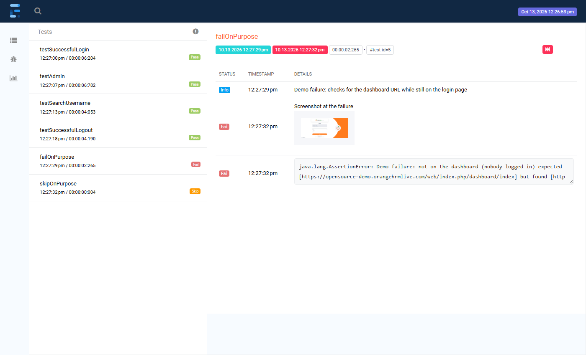
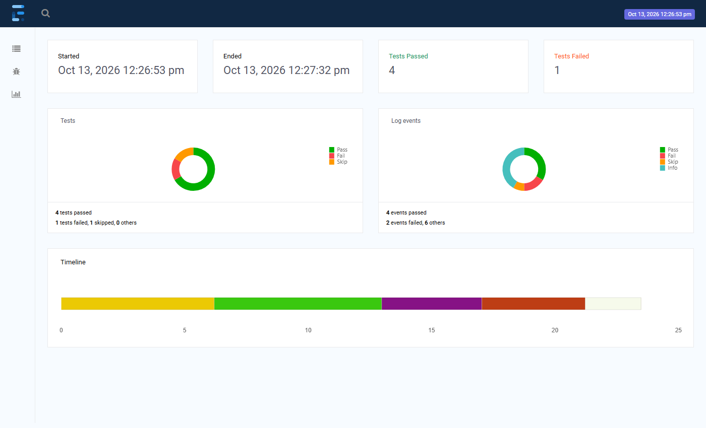
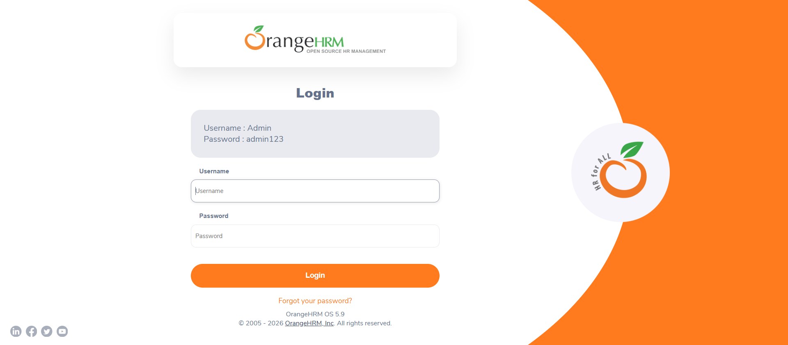

# Java Selenium TestNG Page Object Framework

Selenium 4 + TestNG framework with the Page Object Model, testing the public
[OrangeHRM demo](https://opensource-demo.orangehrmlive.com). First written in January 2024,
then upgraded step by step in October 2026 without changing its design (see the commit history).

- Page objects with their locators, on top of one shared `BrowserAction` class that waits for every element.
- Browser, headless mode and waits come from `config.properties` and can be overridden with `-D`.
- TestNG groups (SmokeTest, Regression), hard and soft asserts.
- Extent Spark HTML report, with a screenshot attached to every failure.

## Contents

- [Stack](#stack)
- [Project structure](#project-structure)
- [How a test run works](#how-a-test-run-works)
- [Configuration](#configuration)
- [Setup and run](#setup-and-run)
- [Report and screenshots](#report-and-screenshots)
- [Report demo: a failure and a skip on purpose](#report-demo-a-failure-and-a-skip-on-purpose)
- [What changed since the 2024 version](#what-changed-since-the-2024-version)
- [Adding a page or a test](#adding-a-page-or-a-test)
- [Known limitations](#known-limitations)
- [License](#license)

## Stack

| Part | Version |
|---|---|
| Java | 17 (tested on 27) |
| Selenium | 4.51.0 (Selenium Manager downloads the browser driver) |
| TestNG | 7.12.0 |
| ExtentReports | 5.1.2 (Spark reporter) |
| Build | Maven, Surefire 3.5.6 |
| Browsers | Chrome, Firefox, Edge; with a window or headless |
| Site under test | OrangeHRM open-source demo (public) |

## Project structure

```
pom.xml
testng.xml                 full suite (default for mvn test)
groupsTestng.xml           same tests selected by group: SmokeTest, Regression
ReportDemoSuite.xml        full suite + one failure and one skip on purpose
src/main/resources/
  config.properties        URLs, demo login, browser, headless, waitSeconds
src/main/java/
  pages/
    BaseClass.java         browser start/stop, config, Extent report, screenshots
    LoginPage.java         login form
    HomePage.java          dashboard side menu (Admin)
    AdminPage.java         System Users search form and user menu (logout)
  browser_actions/
    BrowserAction.java     click, sendKeys, isDisplayed, isEnabled, waitForUrl (all waited)
  listeners/
    TestListener.java      on failure: screenshot into the failed test's report entry
  utils/
    PropertyLoader.java    loads config.properties, applies -D overrides
src/test/java/
  TestClass.java           the 4 OrangeHRM tests
  ReportDemoTest.java      fails and skips on purpose (report demo only)
docs/images/               report screenshots used below
```

## How a test run works

```
mvn test  (-DsuiteXmlFile=testng.xml | groupsTestng.xml | ReportDemoSuite.xml)
   |
   v
TestNG reads the suite file -> registers TestListener
   |
   v
BaseClass (TestClass extends it)
   @BeforeSuite   create the Extent Spark report
   @BeforeClass   PropertyLoader: config.properties + -D overrides
                  createDriver(browser, headless): Chrome | Firefox | Edge
                  open the login page, check its URL
   @BeforeMethod  one report entry per test
   |
   v
TestClass  (one browser session, priority order)
   1 testSuccessfulLogin    LoginPage:  type user + password, click Login  -> dashboard URL
   2 testAdmin              HomePage:   click Admin in the side menu       -> Admin URL
   3 testSearchUsername     AdminPage:  user "Admin", Status = Enabled, Search, Reset
   4 testSuccessfulLogout   AdminPage:  user menu -> Logout                -> login URL
        every page action goes through BrowserAction:
        wait until visible / clickable (up to waitSeconds), then act; URL checks wait via waitForUrl
   |
   v
TestListener.onTestFailure   screenshot -> Screenshots/<test>.png, attached to the test's report entry
BaseClass @AfterMethod       PASS / FAIL (with the exception) / SKIP in the report
BaseClass @AfterClass        close the browser
BaseClass @AfterSuite        write test-output/report.html
```

Step by step:

1. **Suite file.** `testng.xml` runs all 4 tests; `groupsTestng.xml` selects them by group;
   `ReportDemoSuite.xml` adds the demo failure and skip. All three register the listener.
2. **Configuration.** `PropertyLoader` reads `config.properties`; a `-D` value with the same key wins.
3. **Browser.** `BaseClass.createDriver()` starts Chrome, Firefox or Edge, headless at 1920x1080 if
   asked, and opens the login page.
4. **Tests and pages.** The tests only call page methods (`loginPage.enterUsername(...)`); the pages
   hold the locators and pass them to `BrowserAction`.
5. **Waits.** `BrowserAction` waits for each element, and retries a click while OrangeHRM's loading
   overlay is in the way, so there is no `Thread.sleep`.
6. **Asserts.** Hard asserts stop a test at the first broken element; soft asserts collect the URL
   checks and report them together.
7. **Report.** The listener attaches the failure screenshot; `@AfterMethod` records the result;
   `@AfterSuite` writes the report.

## Configuration

`src/main/resources/config.properties`:

```properties
loginPageURL = https://opensource-demo.orangehrmlive.com/web/index.php/auth/login
actualURL    = https://opensource-demo.orangehrmlive.com/web/index.php/dashboard/index
adminPageURL = https://opensource-demo.orangehrmlive.com/web/index.php/admin/viewSystemUsers
userName = Admin            # the public demo account shown on the OrangeHRM login page
password = admin123
browser  = chrome           # chrome, firefox or edge
headless = false            # true = no window (CI), 1920x1080
waitSeconds = 10            # how long BrowserAction waits for an element or URL
```

Any key can be overridden for one run, e.g. `mvn test -Dbrowser=firefox -Dheadless=true`.

## Setup and run

Requirements: Java 17+, Maven, and Chrome, Firefox or Edge. No driver download is needed:
Selenium Manager fetches the matching driver on the first run.

```
mvn test                                        # full suite, visible Chrome
mvn test -Dheadless=true                        # full suite, headless Chrome
mvn test -Dbrowser=edge -Dheadless=true         # Edge (also: firefox)
mvn test -DsuiteXmlFile=groupsTestng.xml        # by group (SmokeTest + Regression)
```

Expected: `Tests run: 4, Failures: 0, Errors: 0, Skipped: 0`, usually in 15-60 seconds depending on how fast
the shared demo site answers. Checked on
visible Chrome and headless Chrome, Edge and Firefox. The tests use the public demo site, so a slow
or reset demo can occasionally fail a run.

## Report and screenshots

| Output | What it shows |
|---|---|
| `test-output/report.html` | Extent Spark report: every test with its steps, PASS / FAIL / SKIP, the exception and the failure screenshot; a dashboard with totals and a timeline |
| `Screenshots/<test>.png` | the browser at the moment a test failed |
| `target/surefire-reports/` | TestNG's own reports |

Screenshots from the report demo run (4 passed, 1 failed, 1 skipped) on Chrome:

**Test view**: the failed test with the screenshot the listener attached and the assertion message:



**Dashboard**: totals, result chart and timeline:



**Failure screenshot** (`Screenshots/failOnPurpose.png`): still on the login page, where the test expected the dashboard:



## Report demo: a failure and a skip on purpose

`ReportDemoTest` has one test that fails on purpose (it expects the dashboard without logging in) and one
that is skipped on purpose (`SkipException` with a reason). They run only in their own suite:

```
mvn test -DsuiteXmlFile=ReportDemoSuite.xml
```

Expected: `Tests run: 6, Failures: 1, Errors: 0, Skipped: 1` and BUILD FAILURE (on purpose). The report
then looks like the screenshots above.

## What changed since the 2024 version

Each step is its own commit, checked with a full run before it was pushed:

| Step | Change |
|---|---|
| Fix | The logout locator `//a[role='menuitem' …]` lacked the `@`, so the logout test had failed on every run since 2024 |
| Dependencies | Selenium 4.16 → 4.51, TestNG 7.7 → 7.12, Extent 5.1.0 → 5.1.2; Surefire runs the suite file |
| Listener | No hard-coded `E:/…` report path and no `Desktop.open` mid-run; the screenshot goes into the failed test's own entry; listener registered once |
| Configuration | Browser, headless mode and waits in `config.properties`, with `-D` overrides |
| Waits | Explicit waits in `BrowserAction` instead of 9 `Thread.sleep` calls (14 s of fixed pauses per run) and an implicit wait |
| Report | One Extent report per suite (it was recreated per class); clearer assertion messages |
| Comments | Every class, page, test, config and suite file documented |
| Report demo | One failure and one skip on purpose, in their own suite |

## Adding a page or a test

1. **Page:** a class in `pages/` that extends `BrowserAction`, with `private By` locators and methods
   that call `click`, `sendKeys`, `isElementDisplayed`, `isElementEnabled`.
2. **Test:** a class in `src/test/java` that extends `BaseClass`, creates the page with
   `new XxxPage(getDriver())` and asserts on its methods; add groups and a priority if it depends on
   earlier tests.
3. **Suite:** add the class to `testng.xml` (and `groupsTestng.xml` if it uses groups).

## Known limitations

- **Tests depend on each other:** they share one browser session in priority order, so a failed login
  also fails the tests after it.
- **One browser at a time:** the driver is static, so classes cannot run in parallel.
- **Live demo site:** OrangeHRM's public demo is shared and reset regularly, which can make a run flaky.
  CI (`.github/workflows/tests.yml`) runs the suite headless on every push, every pull request and once a
  day, so a red daily run can mean the site changed, not the code. The JUnit XML is kept as the
  **junit-tests** artifact, which [Automation Coverage & Quality Intelligence](https://github.com/niranjankagri/automation-coverage-quality-intelligence) collects.
  `main` is protected by a ruleset: changes go through a pull request, and this job must pass first.
- **Locators:** some XPaths rely on CSS classes and positions (e.g. the Status dropdown), which can break
  when OrangeHRM changes its markup.

## License

[MIT](LICENSE)
